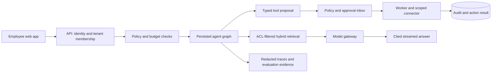

# Architecture proposal

## Scope and principles

A modular monolith first: one API, one worker and one web application. Avoid microservices until measured scaling or deployment constraints justify them. Industry-neutral does not mean automatic compatibility with every enterprise: each connector needs configuration, permission mapping and live validation.

The product includes organization onboarding, memberships, scoped knowledge, citations, chat history, approval inbox, connector settings, audit trail and usage dashboard. The first release supports English and Hindi questions; multilingual retrieval quality must be measured before claiming broad language support.

## Proposed technology choices

| Layer | Choice | Purpose |
| --- | --- | --- |
| Web | Next.js, TypeScript, Tailwind CSS, accessible component primitives | Workspace, chat, approvals and administration |
| API | Python, FastAPI, Pydantic, SQLAlchemy, Alembic | Typed contracts, authorization and persistence |
| Agent runtime | LangGraph with PostgreSQL checkpoints | Explicit routing, bounded tool loops, durable approval pauses |
| Data and search | PostgreSQL with pgvector and full-text search | Tenant data, hybrid retrieval and fewer operational services |
| Queue/cache | Redis and Celery | Retryable ingestion, provider concurrency and isolated caches |
| Files | S3-compatible storage; local adapter for development | Private originals and document versions |
| Identity | OIDC provider, initially Keycloak for reproducible development | Login and organization membership |
| Model gateway | Gemini and Groq adapters behind one typed interface | Streaming, timeouts, usage capture and evaluated routing |
| Telemetry | OpenTelemetry; optional Langfuse integration | Request, retrieval, tool and provider traces |
| Delivery | Docker Compose and GitHub Actions | Repeatable local setup and CI gates |

These are proposed choices, not installed dependencies. Verify SDK APIs and model availability during implementation, choose tested versions and commit lockfiles. Do not assume either supplied key grants access to a particular model. Benchmark local multilingual embeddings against available hosted embeddings before selecting the default.

## Request flow

## Security invariants

- Derive identity from a verified session/token. Resolve tenant membership server-side; never trust a supplied tenant ID or role as authorization.
- Enforce tenant boundaries in queries and PostgreSQL row-level security with a non-owner application role. Background jobs bind the same context. Test cross-tenant access through every object endpoint.
- Enforce document visibility before search results enter reranking or the prompt. Apply ACLs to citations, previews, original-file downloads, histories and cached answers too.
- Treat retrieved content and tool results as untrusted data. Prompts and injection detection add defenses; code-enforced permissions remain authoritative.
- Authenticate each MCP resource using its intended audience and scoped credentials. Never forward arbitrary inbound tokens to downstream resources. Use delegated authorization or an explicit token exchange where supported.
- Validate tool arguments against schemas and allowlists. Unknown tools and destinations fail closed. Exclude arbitrary shell execution and unrestricted SQL.
- Bind approvals to requester, organization, exact arguments and expiry. Editing arguments requires a new approval. Recheck authorization at execution time.
- Use idempotency keys, an action ledger and an outbox. A timeout after an external write enters an uncertain state for reconciliation; do not blindly retry.
- Partition caches by organization, identity/permission fingerprint, prompt/model version and document-index version. Initially use exact caching; enable semantic reuse only after isolation and similarity evaluations.
- Redact sensitive trace attributes and avoid logging raw documents by default. Define retention and deletion behavior for files, chunks, chat and traces.
- Restrict connector destinations and block internal/metadata addresses to mitigate SSRF. Validate upload type/size, sanitize filenames and sandbox parsers.
- Implement rate limits, per-run step/token limits and atomic budget reservations. Estimate cost from configured price tables; expose unknown pricing rather than inventing a cost.

## Core records

Organizations, users, memberships, departments, role grants, documents, document versions, ACL grants, ingestion jobs, chunks, conversations, messages, agent runs, tool proposals, approvals, action ledger, connectors, credential references, usage reservations, audit events, prompt versions and evaluation runs.

Every tenant-owned record carries an organization ID. Document versions have content hashes and index status. New versions become searchable atomically; deletion invalidates retrieval and caches. Provider/connector secrets remain server-side, encrypted at rest or stored in a secret manager.

## Retrieval and generation

Extract PDF, Markdown and text first; add DOCX after parser validation. Chunk by structure and preserve page/heading provenance. Combine full-text and vector results, fuse rankings, then evaluate whether reranking improves relevance enough to justify latency. Require citations backed by retrieved chunk IDs. If evidence is insufficient, abstain or ask a clarifying question.

Use conversation summaries with bounded history; do not persist speculative personal facts as trusted memory. Stream typed events for retrieval, approval required, answer deltas, citations, completion and failure. Escape rendered output and validate source links.

## First workflow

Create a local IT ticket through a real application service. The agent drafts a proposal, the employee approves, the service persists the ticket and the conversation receives its ID. Add an MCP server/client boundary for this service next. External Jira or Slack integration is a separate milestone requiring account configuration; local tickets must never be described as external tickets.

## Operational definition of done

Verified migrations, readiness checks, backup/restore exercise, reproducible demo seed, repeatable integration tests, retrieval/evaluation report, failure recovery tests, documented deployment and no committed secrets. Hosted production readiness additionally requires a chosen provider, domain, TLS, real identity configuration and live connector validation.
