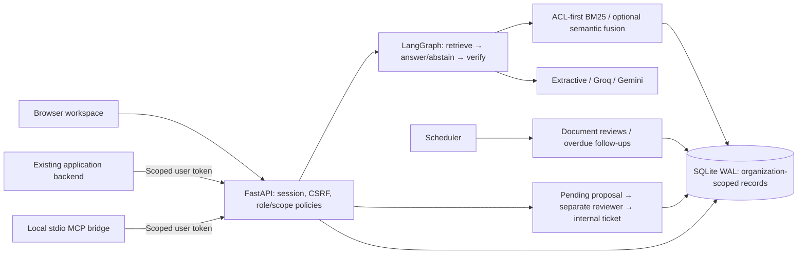

# Shipped architecture

The current v0.2 architecture is described in [Multi-agent operations](MULTI_AGENT_OPERATIONS.md): a configurable specialist DAG, coordinator-selected read tools, quantitative datasets, durable checkpoints and artifact versions, model profiles, feedback rounds, approved connector actions, work outcomes, recurring missions and signed events. The foundation diagram and decisions below describe the earlier knowledge path, which remains available alongside Mission Control.

## Decisions

**Buildless frontend first.** The proposal suggested Next.js. v0.1 uses accessible HTML/CSS/JavaScript on the API's origin, avoiding a second application server, build requirement and cross-origin cookies. Node is development-only. A future framework migration must preserve API/security contracts.

**Bounded graph.** Knowledge Q&A uses a real LangGraph workflow. It skips provider calls without evidence, verifies citation references and terminates after fixed nodes. Citation format checks do not establish semantic entailment. The graph has no long-running checkpoint requirement; durable approvals use the SQL state machine.

**Atomic local actions.** Proposals bind immutable arguments and requester-scoped idempotency keys. A separate reviewer decides. Conditional updates prevent two reviewers both claiming pending state; ticket creation and approval commit together, backed by a unique action ID. This guarantee applies to local database effects. External execution needs an outbox and reconciliation.

**Reproducible pilot database.** SQLite WAL supports local web/worker processes. ORM portability is not a claim of PostgreSQL readiness: no RLS is installed or verified. Application filters enforce organization/document boundaries, so production mode fails closed until hardening is complete.

**Explicit retrieval modes.** BM25 is the lexical baseline. Optional sentence-transformers adds cosine ranking fused with lexical ranks, after ACL filtering. It currently re-encodes the accessible corpus per query; it is not a persistent enterprise vector index. Install the `semantic` extra and configure `AIVORA_SEMANTIC_MODEL` to experiment and benchmark.

**No speculative answer cache.** v0.1 has no answer caching or quality-adaptive model router. The evidence/no-evidence route saves unnecessary cloud calls. Document replacement invalidates historical references. Cache isolation, invalidation and quality evaluation precede future semantic caching.

**Local MCP.** The official v1 Python SDK provides stdio transport. The bridge uses a purpose-issued AIVORA token rather than forwarding arbitrary external credentials. It is not a hosted OAuth resource server.

**Data-minimized traces.** Run records contain statuses, timings, source counts, reported tokens, prompt version and graph stages. Audit records contain event/resource/actor IDs. Ambient LangSmith export is disabled around graph invocation to avoid accidental document export. An OpenTelemetry exporter and monetary cost dashboard are not shipped.

## Code map

| Module | Responsibility |
| --- | --- |
| `api.py` | Request schemas, endpoint policy, lifecycle and transaction orchestration |
| `security.py` | Scrypt passwords, hashed credentials, sessions, CSRF, roles/scopes |
| `db.py` | Models, uniqueness constraints, SQLite settings |
| `retrieval.py` | Extraction, chunking, ACL predicates and ranking |
| `graph.py` | Retrieve/answer/abstain/verify orchestration |
| `providers.py` | Fixed-destination cloud adapters and source extraction |
| `automation.py`, `worker.py` | Persistent schedules and deduplicated tasks |
| `mcp_server.py` | Authenticated MCP-to-REST bridge |
| `backup.py` | Online backup and integrity verification |
| `static/` | Workspace and self-contained API reference |

For learning, follow one question from browser through authentication, retrieval, graph and persistence. Then follow a request's lifecycle and read the simultaneous-reviewer/restart tests. Compare the implementation with the target architecture and add each missing boundary with measurable acceptance evidence.
